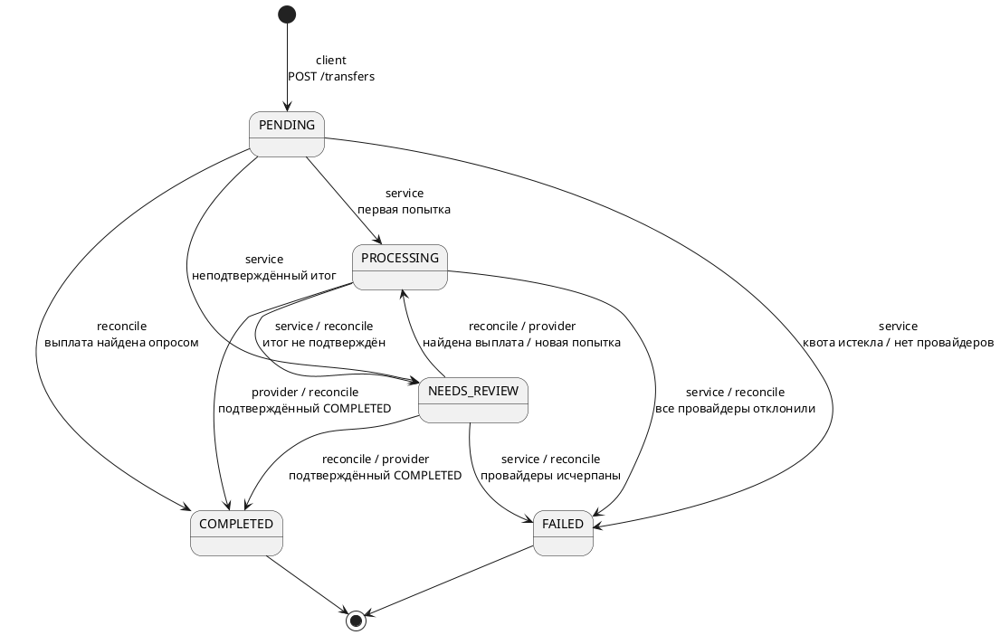

# DECISIONS

Все принятые решения по Transfer Core (Python). Причины — здесь, в коде комментариев нет.

## D1. Scope — всё включая chaos

Цель: Level 1–2 полностью + Level 3 + chaos_run на 300 переводов без двойных выплат и зависших резервов.

Причина: инварианты Level 2 (`доступно + резерв + списано = старт`) проверяются только хаосом (дубли, обрывы, беспорядок webhook). Частичная надёжность оставляет резерв висеть.

## D2. Деньги — Decimal, HALF_UP, split scale

- Тип: только `decimal.Decimal`, `float` запрещён везде (логика, БД, DTO).
- Округление: `ROUND_HALF_UP` в едином модуле `core/money.py`.
- Хранение: `NUMERIC(20, 8)` для сумм, ставок, комиссий.
- Показ: строка с точностью `minor_units` валюты из `currencies.json`.

Причина: округление до 2 знаков до записи превращает мелкие суммы в `0.00` и месячный итог перестаёт двигаться. Ставку нельзя округлять до умножения. Split «храним точно — показываем по minor_units» удовлетворяет ТЗ (ТЗ про строки на API, хранение — наше решение).

## D3. TARGET-режим — инверсия формулы

`source = (target / rate + fixed) / (1 - percent)`, затем проверка минимума комиссии и округление вверх до `minor_units`. Результат верифицируется прямым прогоном SOURCE (examples #1 ↔ #3 должны сходиться).

Причина: итеративный подбор недетерминирован и дорог; замкнутая формула + проверка даёт согласованность обоих режимов одним кодом.

## D4. Курсы — live + общий кэш 60 с

Каждый `POST /quotes` и каждый перевод идут в `GET mock-provider/rates`; ответы кэшируются на 60 секунд в разрезе базового URL (`RatesClient`, `CACHE_TTL_SEC`; свежие пары поверх — в памяти процесса). `rates.json` — только сид и фолбэк тестов. Курс старше `min(quote_ttl_sec, 6ч)` или отсутствующая пара — `RATE_UNAVAILABLE`, молчаливых подмен нет (протухший прямой курс не заменяется кроссом).

Причина: ТЗ требует актуальные курсы из мок-провайдера; снимок в репозитории быстро протухает. Кэш на уровне клиента ограничивает шторм запросов при 50–100 параллельных; свежесть для расчёта проверяется отдельно в `resolve_rate`.

## D5. POST /transfers — синхронно с таймаутом, дальше 202

Ждём ответ провайдера до таймаута (`api_sync_timeout_sec = 12`, общий дедлайн на весь запрос включая перебор провайдеров), затем возвращаем `202` + текущий статус (`PROCESSING` или `NEEDS_REVIEW`). Клиент добирает результат поллингом `GET /transfers/{id}` и вебхуками; сверка доводит перевод до терминала. Терминальный синхронный итог: `COMPLETED` → `201` + `Location`, `FAILED` → `200`. Поведение при slow 30 с — клиент видит `PROCESSING`, деньги в резерве.

Причина: вечное синхронное ожидание держит соединение и пул; мгновенный 202 усложняет минимум Level 2 (проверяющий ждёт статус в ответе ok-сценария). Гибрид закрывает оба сценария.

## D6. State machine — явный граф в TransferStateMachine

Состояния: `PENDING → PROCESSING → COMPLETED / FAILED`, плюс `NEEDS_REVIEW` для неподтверждённых итогов (`PROCESSING → NEEDS_REVIEW → {PROCESSING, COMPLETED, FAILED}`, `PENDING → NEEDS_REVIEW`). Терминальные (`COMPLETED`, `FAILED`) необратимы; `CANCELLED` нет — отмена перевода не предусмотрена ТЗ.

Акторы фиксируются в истории каждого перехода (`transfer_status_history`): клиент создаёт (`PENDING`), синхронный путь ведёт попытки (`service`), провайдер/вебхук завершает (`provider:<id>`), фоновая сверка доводит зависшие (`reconcile`). Полная схема с акторами — в D31. История переходов — источник для `GET /transfers/{id}.history`.

Причина: наружу нужен чистый контракт для проверяющего; внутреннее состояние ретраев нужно для аудита «кто, когда, с каким результатом» без раздувания публичного контракта.

## D7. Провайдеры — цепочка фильтров + взвешенный скоринг

Цепочка в `services/providers.py`: фильтры направления → лимитов → доступности → маржи, затем скоринг и исполнитель попыток (`ProviderClient`). Каждый фильтр — чистая функция, тестируется отдельно (`respx` для HTTP-клиента).

- Фильтр жёсткий: direction совпал, сумма в валюте провайдера внутри min/max (конвертация свежими курсами, BFS до 3 рёбер через `convert_amount`), `enabled = true`, сейчас не в `maintenance_windows`. Мок терпит ±10% к лимитам (`within_limits`), наш фильтр строже — это норма, не баг.
- Маржа `= (fee_клиента − fee_провайдера) / source_amount ≥ min_margin_percent`, все суммы в одной валюте (комиссия провайдера считается от суммы в его валюте и переводится в валюту источника).
- Скоринг среди прошедших: `score = 100·margin + 50·success_rate − p95_ms/1000`, веса — константы `W_*` (`Decimal`) в `services/providers.py`.
- Неподтверждённый итог — сначала проверка (см. R-03): обрыв / таймаут / `504` после отправки означает «запись может уже существовать» — сначала `GET /{provider_id}/payouts?reference=<наш id>` с повторами; запись есть — привязать попытку и ждать/сверить. Если опросы в окне видимости вернули `missing` — запись считается несозданной: попытка `FAILED (PROVIDER_UNREACHABLE)`, сразу следующий провайдер (вариант A, см. D32). Провайдер нечитаем (ошибки проб) — `NEEDS_REVIEW`, без перехода.
- Никто не проходит по марже — `FAILED` без отправки денег, резерв назад.

Таблица ответов мок-провайдера на `POST /{provider_id}/payouts` и реакция сервиса:

| HTTP / код мока | Трактовка | Действие |
| --- | --- | --- |
| `201`, статус `PROCESSING`/`COMPLETED` | принято | привязать `payout_id`, ждать сеттлмента |
| `422` (`RECIPIENT_ACCOUNT_INVALID`, `CURRENCY_NOT_SUPPORTED`, `AMOUNT_OUT_OF_LIMITS`) | окончательный отказ | `FAILED`-попытка, следующий провайдер |
| `503` (`PROVIDER_DISABLED`, `PROVIDER_MAINTENANCE`) | отказ без записи | `FAILED`-попытка, следующий провайдер (такие провайдеры заранее отсекаются фильтром доступности) |
| `500` / таймаут / обрыв (`error_5xx`, `DROP_LOST`, `HANG_CREATED`) | итог зависит от опросов | `create_with_recovery`: повтор тем же ключом + опрос `GET ?reference=` в окне видимости; опросы нашли запись — привязать выплату и ждать/сверить; опросы с `missing` — запись считается несозданной: попытка `FAILED (PROVIDER_UNREACHABLE)`, сразу следующий провайдер (вариант A, см. D32). Провайдер нечитаем (ошибки проб) — `NEEDS_REVIEW` |
| `504` (`ERROR_CREATED`), создание подтверждено опросом | запись есть | привязать `payout_id` и ждать/сверить |
| `409` | чужой ключ с другим телом | `UnknownResult`, затем `NEEDS_REVIEW` (свой ключ детерминирован, такое не встречается) |

Причина: ТЗ требует разделить расчёт, выбор и HTTP-клиент. Цепочка делает это буквально и тестируется позменно через `respx`. Маржа — защита экономики сервиса; молчаливое взятие убыточного провайдера запрещено. Трактовка `5xx` — вариант A (см. D32): опросы с `missing` в окне видимости означают «точно не создано», поэтому следующий провайдер пробуется сразу, а не через сверку.

## D8. Идемпотентность — тот же ключ + другое тело = 422 (в пределах клиента)

`Idempotency-Key` + хеш тела. Совпало — вернуть тот же `transfer_id`. Тело отличается — `422 IDEMPOTENCY_CONFLICT`, второй перевод не создавать. Ключ уникален в пределах клиента (`UNIQUE(client_id, idempotency_key)`): разные клиенты вправе использовать одинаковые ключи. Дубли ключа при конкурентных запросах сериализуются блокировкой клиента + повторной проверкой после неё; гонка вставки ловится savepoint'ом в `create_transfer_or_existing`.

Причина: молчаливое игнорирование чужого тела прячет баги клиента; создание второго перевода ломает инвариант «повтор не создаёт операцию».

## D9. Балансы — строгий резерв, блокировка клиента первее чтения

Одна транзакция: блокировка строки клиента (`lock_client`) → повторная проверка ключа идемпотентности → `создать запись перевода → SELECT … FOR UPDATE строки баланса → проверить доступно ≥ source+fee и лимиты → положить резерв`. Дубли ключа упираются в `UNIQUE(client_id, idempotency_key)` и ждут первую транзакцию. Финал: `COMPLETED` списывает резерв в `spent`, `FAILED` возвращает в доступно.

Причина: порядок «сначала блокировка клиента, потом чтение итога» исключает двойное списание при параллельных заявках: без `FOR UPDATE` две заявки видят один доступный остаток. Проверка — инвариантом из Level 2.

## D10. Вебхуки — строгий вариант + сверка

- `UNIQUE(event_id)`: дубль — `200` без эффекта.
- Монотонность: не-терминал не перетирает терминал; спор не-терминалов решает `occurred_at`.
- Неизвестный `payout_id`/`reference` — `200 + warn-лог + метрика unknown_webhooks_total` (не 404, чтобы не вызывать шторм ретраев).
- Подпись: HMAC обязателен, несовпадение/отсутствие — `401`. Проверено в `mock_provider/webhooks.py`: обычная доставка всегда подписана корректным секретом, без/кривая подпись — только chaos-ветка `forged` (6%: `missing`/`invalid`) с заведомо ложным статусом, её отклонение корректно. Риск из A8 снят, строгость остаётся.
- Сверка обязана переживать ложь чтений мока: `visibility_lag` 3–15 с (свежая выплата — `404`) и `stale_read` 1–3 с (`GET` возвращает `PROCESSING` после settle). Вывод: поллинг с повторами и сходимостью, одиночный `GET` итогом не считается.
- Фоновая сверка: джоб каждую минуту (`reconcile_interval_sec=60`, до 8 параллельных воркеров) обходит открытые переводы (`PENDING`, `PROCESSING`, `NEEDS_REVIEW`) с `FOR UPDATE ... SKIP LOCKED`, опрашивает провайдера и доводит до терминала. Перекрёстная сверка с `admin/ledger` — задача `scripts/chaos_run.py`, а не сервиса: ledger есть только у мок-провайдера, и тащить его формат в прод-код нельзя.

Причина: вопросы Level 3 (дубли, беспорядок, неизвестные, падение между отправкой и записью) иначе дают двойные выплаты и зависшие резервы. Сверка — единственный способ узнать статус при потерянном ответе.

## D11. Лимиты — стратегия со скользящим окном, дефолт суточный

Дефолт — суточный лимит клиента из `clients.json`. Схема с первой миграции обобщённая:

- справочник `limit_period_types`: `MINUTES, HOURLY, DAILY, WINDOW_N`;
- `limit_definitions`: scope (`client` / `client+direction`), `period_type`, `window_days` (7/16/любое; для `MINUTES` — минуты), `amount`, `currency`, `weight`, `is_active`, `UNIQUE(client, scope, period)`;
- использование — агрегацией по `transfers` за окно (`created_at >= now() − window`), индексы `(client_id, created_at)` и `(client_id, category, created_at)`, без таблицы счётчиков;
- часовой лимит отдельным значением не зашит: окно `HOURLY` — последний час, `DAILY` — календарные сутки UTC (полуночь, строгое `>`, ноль — не превышение);
- код: `check_daily_limit` + `check_limit_definitions` в `app/services/limits.py`, конвертация в валюту лимита через курс котировки или прямой/обратный/кросс-курс живых rates; неконвертируемая сумма — `RATE_UNAVAILABLE`, а не молчаливый пропуск (fail-closed).
- Справочники без DB ENUM: валюты — только FK к `currencies` (заглавные ISO-коды, `UNIQUE`), статусы переводов — FK к `transfer_statuses`, статусы попыток и событий вебхуков — FK к `attempt_statuses`, периоды — FK к `limit_period_types`, страны/способы выплаты — FK к своим таблицам. Статус события вебхука тоже FK, не свободная строка.

Причина: лимиты «взвешенные по категориям, сумма, плавающее окно 7/16 дней + часовой» требуют агрегатов по дате — это уровень схемы (индексы, типы периодов), а не косметика в сервисе. Отдельные счётчики разъезжаются со сверкой, поэтому считаем по факту переводов. Валюта встречается в 8+ таблицах — свободные строки дают дубли (`kzt` vs `KZT`) и висячие коды; только FK + lookup-проверка в API закрывают беду.

## D12. Служебные эндпоинты — закрыть

Роутов `/env`, `/.env`, `/actuator`, `/metrics`, `/info` нет. `docs/openapi.json` — только dev-профиль. Неизвестный служебный путь — `404` без утечки конфига. `GET /health` — минимальный liveness. Параметры PG через `SHOW` — только внутри тестов, не эндпоинтом.

Причина: утечка конфига и метрик наружу — провал защиты; проверяющему эти пути не нужны.

## D13. Зависимости — только uv, DB-профили, PG RAM

- `pyproject.toml` + `uv.lock`, `uv sync --frozen`, `uv run …`; `pip`/`venv`/`requirements.txt` запрещены везде включая `Dockerfile`.
- `DB_PROFILE`: `postgres` (основной), `mysql`, `sqlite` (локально) через `pydantic-settings`.
- PG RAM выше дефолтов (`shared_buffers 512MB`, `effective_cache_size 1536MB`, `work_mem 16MB`, `maintenance_work_mem 128/256MB`, `shm_size: 1gb`, `random_page_cost 1.1`, `max_connections ≥ pool_size × воркеры + резерв`), всё через `.env` (`PG_*`), обоснование формул — здесь при реализации. `.env.example` — источник истины, реальный `.env` в `.gitignore`. `DB_PORT_HOST` — только маппинг порта для хоста, на приложение не влияет.
- `float` остаётся только на границах, не в бизнес-логике: таймауты настроек (`mock_provider_timeout_sec`, `api_sync_timeout_sec`, `reconcile_interval_sec`) и `ProviderClient(timeout_sec)` — там `float` требует `httpx` и сериализация `pydantic-settings`. Суммы, курсы и веса — только `Decimal`, интервалы — `timedelta`.

Причина: дефолты PG (`shared_buffers 128MB`, `work_mem 4MB`) душат параллельные запросы; пул SQLAlchemy без согласованного `max_connections` даёт `TimeoutError` при 50–100 конкурентных.

## D14. Тесты — полный набор

Unit (калькулятор, коды ошибок, скоринг и HTTP-клиент через `respx`, `pytest-check` soft assertions) + arch-тесты границ слоёв (import-linter) и отсутствия `try/except` в сервисах + интеграционные тесты на реальном PostgreSQL в отдельных БД `transfer_test_{worker}` + `pytest -n auto` + нагрузочные (`asyncio.gather`, 50–100 параллельных) + проверка `SHOW shared_buffers/work_mem/max_connections` + явный прогон миграций (`alembic upgrade head` на чистой БД). Всё одной командой `uv run pytest`.

Отклонение от SPEC: вместо `testcontainers` тесты поднимаются на внешнем PostgreSQL из `docker compose` (та же версия образа, `testcontainers` лишь дублировал бы его). Изоляция — отдельная БД на воркер + `DROP/CREATE` схемы на тест. Зафиксировано в LIMITS.

## D15. Раскладка артефактов и правило без комментариев

`README.md` — в корне; `DECISIONS.md`, `ASSUMPTIONS.md`, `LIMITS.md`, `er_diagram.puml`, `grill-log.md` — в `docs/`. В коде ноль `#`-комментариев; `Field(description=…)` — контракт, не комментарий. Контроль — arch-тестом/линтом при реализации.

## D16. Схема БД — 3НФ, справочники вместо ENUM

Таблицы: `currencies`, `countries`, `payout_methods`, `directions`, `providers`, `provider_directions`, `maintenance_windows`, `clients`, `balances`, `quotes`, `transfer_statuses`, `transfers`, `transfer_status_history`, `attempt_statuses`, `payout_attempts`, `webhook_events`, `limit_period_types`, `limit_definitions`. Ни одного DB-ENUM: статусы переводов — FK к `transfer_statuses`, статусы попыток и событий вебхуков — FK к `attempt_statuses`, периоды лимитов — FK к `limit_period_types`, страны и способы выплаты — FK к своим таблицам. Статус события вебхука тоже FK. История переходов ссылается на `transfer_statuses` обеими колонками (`from_status`, `to_status`) — свободные строки убраны (миграция 0007).

Нормализация сверх 3НФ (миграция 0007): уникальность лимитов включает направление (`client_id, scope, period_type, direction_id`; `NULL` в `direction_id` не конфликтуют, client-правила друг другу не мешают); мёртвая колонка `category` удалена; `direction` без `direction_id` запрещён CHECK-ом; `fee_charged_in` ограничен `('SOURCE','TARGET')`. Недостающие индексы под FK достроены (`payout_attempts.provider_id`, `webhook_events.provider_id`, `limit_definitions.direction_id`).

Осознанно не нормализовано: снапшот сумм в `quotes`/`transfers` (фиксация цены), `funds_settled` (факт движения денег отдельно от статуса), `payout_attempts.reference` (ключ поиска), получатель внутри `transfers`, `clients.daily_limit_*` отдельно от `limit_definitions` (быстрый дефолт), курсов в БД нет (мок + `rates.json`).

Причина: требование SPEC «никаких DB-уровневых ENUM»; добавление статуса/периода — вставка строки сидером, а не миграция типа. Разделение `transfer_statuses` / `attempt_statuses` фиксирует разные жизненные циклы: перевод (деньги клиента) и попытка у провайдера (деньги провайдера).

## D17. Ключи справочников — естественные коды, не суррогаты

PK справочников — коды (`VARCHAR(3)` для валют, `VARCHAR(2)` для стран). `VARCHAR(3)` в зависимых таблицах — тип внешнего ключа под PK, а не свободная строка; целостность держит `FOREIGN KEY`, дубли кодов запрещает `UNIQUE`.

Причина: сиды (`currencies.json`, `providers.json`, `clients.json`) оперируют кодами — естественный ключ ложится один в один без маппинга id↔код, API и ledger читаются без джойнов. Цена — переименование кода только миграцией; регистр фиксируем верхним с валидацией в API (см. A12).

## D18. ER-диаграмма — оформление и полнота связей

Подписи сущностей, полей и связей — на русском (`перевод_id`, `котировка_id`, `клиент_id`, `провайдер_id`, `направление_id`, `событие_id`, `выплата_id`, `попытка_id`, `окно_id`, `лимит_id`); типы колонок — как в БД. Все 8 связей валют нарисованы явно (`Валюты → Направления, Провайдеры, Клиенты, Балансы, Котировки, Переводы, Попытки выплат, Определения лимитов`). Ортогональные ломаные убраны — обычные кривые связи. Масштаб `scale 1.2` (3719×1436) + векторный `er_diagram.svg` для зума.

Причина: обрезанная веерная диаграмма прятала беду с валютой; явные линии делают каждое вхождение валюты проверяемым глазами. Кривые вместо ortho — читаемость при 19 связях. SVG — чтобы мелкий текст полей читался на любом зуме.

## D19. Индексы и блокировки на уровне схемы

`UNIQUE`: `currencies.code`, `uq_transfers_client_key(client_id, idempotency_key)` (ключ уникален в пределах клиента, два клиента могут использовать один ключ), `webhook_events.event_id`, `uq_attempt_transfer_no(transfer_id, attempt_no)`, `limit_definitions(client, scope, period)`. Индексы: `(client_id, created_at)` и `(client_id, category, created_at)` на `transfers` под скользящие окна, `ix_transfers_updated(updated_at)` — порядок обхода открытых переводов сверкой (старые висяки не голодают, новые не ждут), `(provider_id, direction_id)` на `provider_directions`; `(provider_id, from_at, to_at)` на `maintenance_windows`; `(reference)` на `payout_attempts` под сверку и вебхуки; `ix_transfer_status_history_transfer(transfer_id)` под историю. CHECK: `available/reserved/spent >= 0` на `balances` (вторая линия обороны после кода). Схема держит пессимистику: строки `balances` и `transfers` блокируются через `SELECT … FOR UPDATE` по PK; сверка берёт открытые переводы с `SKIP LOCKED`, чтобы N реплик не толкались.

Причина: окна 7/16 дней и часовой лимит — агрегаты по дате, без индексов они деградируют первыми под нагрузкой. `UNIQUE` — вторая линия обороны идемпотентности после проверки в сервисе.

## D20. Стартовый набор — вендорный код без правок

`data/`, `examples/`, `scripts/chaos_run.py` и `mock_provider/` взяты из `transfer-core-starter` без изменения логики. Единственная адаптация — запуск мок-провайдера через `uv run python -m mock_provider.main` (вместо `pip install -r requirements.txt`), как требует D13. `aiohttp` добавлен в зависимости. Код мок-провайдера исключён из ruff как вендорный.

Причина: стартовый набор — входные данные задачи, а не наш код; правки в нём искажают проверку. `payment-stack-starter` — другой набор (Vault, RabbitMQ, worker, reporting), к Transfer Core не относится и не переносится.

Последствия данных, которые схема обязана выдержать: `minor_units` от 0 до 3 (JPY/VND/KWD), `charged_in=TARGET`, лимиты клиента в валюте, отличной от баланса, отсутствующие и протухшие курсы, выключенный провайдер и окно обслуживания. Детали — `docs/starter-notes.md`.

## D21. Реализация: ядро, провайдеры, финализация

- Расчёт: `app/services/quotes.py`, деньги — `app/core/money.py` (HALF_UP, квантование по minor_units), общие DTO — `app/core/types.py` (чтобы `repositories` не зависели от `services`).
- Провайдеры: цепочка фильтров в `app/services/providers.py`; комиссия провайдера считается от суммы в его валюте и переводится в валюту источника; скоринг `score = 100·margin + 50·success_rate − p95_ms/1000` (константы `W_*` — `Decimal`, см. R-23), маржа ниже `min_margin_percent` отбрасывается.
- Неизвестный итог: `create_with_recovery` — ключ идемпотентности детерминирован (`reference:provider_id`), сначала `GET ?reference=` с повторами, затем повторный POST тем же ключом; к следующему провайдеру только если записи нет.
- Финализация атомарна: `UPDATE … WHERE status NOT IN (term)` + проверка `rowcount`, поэтому sync-путь, вебхук и сверка не списывают резерв дважды.
- Лимиты: суточный по UTC-дате + `limit_definitions` (`HOURLY`, `DAILY`, `WINDOW_N`) с весом.
- Тесты — на реальном PostgreSQL в отдельной БД `transfer_test`, чтобы не трогать dev-данные; API-тесты на `httpx.AsyncClient` + `ASGITransport` в одном event loop.

Причина: chaos-прогон на 60 переводах дал `RESULT: OK` только после детерминированного ключа и атомарной финализации — до этого было 9 двойных выплат. Это подтверждает D7 и D10 на практике.

Обоснование весов скоринга (R-23): формула сознательно ставит надёжность выше цены. Разброс `success_rate` 0.62–0.999 даёт вклад 31–50 баллов, а маржа 0.5–1.5% — лишь 0.5–1.5 балла; `p95/1000` — штраф 0.5–3.5 балла. Пример для `RU-TH-BANK`, source 10000 RUB, fee 150 RUB, target 4137 THB (курсы из `rates.json`): echo (fee 41.45 RUB, success 0.98, p95 1200) — score 48.89; alpha (55.97, 0.97, 1800) — 47.64; charlie (93.78, 0.995, 3500) — 46.81; bravo (14.40, 0.62, 900) — 31.46; golf (fee 267.57 RUB, маржа −1.18%) — отсеян фильтром `min_margin_percent = 0.5%`. Порядок определяется надёжностью при сравнимой цене: echo выигрывает у alpha за счёт чуть более высокой маржи (+0.15 п.п. → +0.15 балла) и меньшего p95 (+0.6 балла), но bravo с минимальной комиссией (fee 14.40) проигрывает из-за `success_rate 0.62` (−18.5 балла). Такое ранжирование — осознанный выбор: дешёвый, но падающий провайдер дороже в ретраях и поддержке, чем надёжный с комиссией выше.

## D22. Логирование с маскировкой секретов и мапперы

- Логи — структурированный JSON (`app/core/logging.py`): `ts`, `level`, `logger`, `message`, `request_id` + поля `method/path/status/transfer_id/provider_id`.
- `request_id` пробрасывается через `ContextVar` и возвращается клиенту заголовком `X-Request-ID`.
- Маскировка: `RedactingFilter` + `JsonFormatter` заменяют на `*****` значения по ключам (`password`, `secret`, `token`, `api_key`, `authorization`, `x-signature`, `cookie`, `private_key`) и по шаблонам (`Bearer …`, `key=value`, JSON-пары). Маскируется уже собранное сообщение, чтобы не ломать `%s`-плейсхолдеры.
- uvicorn access-log отключён (`--no-access-log`): он печатает query string и заголовки сырыми, то есть утекает `?token=…`. Наш middleware логирует только путь без query.
- Мапперы — `app/api/mappers.py`: ORM/DTO → ответы (`QuoteResponse`, `TransferResponse`, `BalanceResponse`). Роуты больше не собирают ответы вручную.

Причина: утечка токена в логах — это провал проверки, а не косметика; access-log uvicorn это делал буквально. Отдельный слой мапперов держит `api` тонким и убирает дублирование форматирования денег.

## D23. Chaos 300: два реальных бага и их фиксы

1. **Ретрай прилипал к упавшему провайдеру.** `run_attempts` считал «живой» любую попытку с `payout_id`, включая `FAILED`, и вместо следующего провайдера бесконечно ждал её сеттлмента. 10 переводов зависли в `PROCESSING`. Фикс: «живой» = `PROCESSING`/`COMPLETED`; провайдеры с уже сделанной попыткой исключаются из перебора.
2. **Противоречивый вебхук завершал перевод.** Событие `COMPLETED` без сверки с провайдером закрывало перевод, хотя реальный итог был `FAILED` (chaos `contradiction`, 4%). Получился `success_without_payout`. Фикс: перед завершением по вебхуку — `GET payout`/`find_payout` и завершение только при подтверждённом `COMPLETED`; плюс монотонность по `occurred_at` (события старше последнего сохранённого игнорируются).
3. **Сверка больше не перетирает терминальный перевод:** перед обновлением попытки проверяется свежий статус перевода.

Причина: chaos ловит именно те дефекты, которые не видны в unit-тестах — «прилипший» ретрай и доверие вебхуку без подтверждения. Оба сценария теперь закреплены в тестах (`test_late_processing_does_not_override_terminal`, `test_webhook_completes_transfer` с проверкой `GET payout`).

## D24. Конвертация для лимитов провайдера — поиск по графу курсов

`convert_amount` строит граф из курсов (ребро в обе стороны), ищет путь BFS до 3 рёбер и возвращает первое найденное произведение. Это закрывает цепочки с обратным ребром (`VND → RUB → EUR`), которые не покрывались прежними direct/inverse/2-hop правилами.

Причина: на chaos 300 обнаружились 39 `FAILED` без попыток на `RU-VN-BANK` — сумма в VND, провайдеры в EUR/USD, а старый конвертер не умел `VND →(inverse) RUB → EUR`. Фильтр молча отбрасывал всех провайдеров. После правки направление обслуживается.

## D25. Фиксы по итогам ревью тестов

Ревью шестью агентами (отчёты в `docs/test-cases/reviews/`) дало подтверждённые дефекты; закрыты:

- **TARGET недоплачивал.** Ветка «процент vs минимум» выбиралась по промежуточной сумме; теперь кандидат проверяется прямым пересчётом `calculate_source` и при комиссии ниже минимума берётся минимум. Регрессии: `RU-TH-CARD 1020 THB`, `RU-VN 2 070 000 VND`, `KW-JP 19 890 JPY`.
- **Курс 0/отрицательный/NaN принимался.** `_valid_rate` требует конечное значение > 0; проверка на direct, inverse и обеих ногах кросс-курса.
- **Протухший direct подменялся кросс-курсом.** Если прямой курс есть, но устарел — `RATE_UNAVAILABLE`, без тихого обхода.
- **Идемпотентность проверялась после `expires_at`.** Повтор с тем же ключом после истечения котировки возвращает существующий перевод, а не `410`.
- **Гонка `Idempotency-Key` давала 500.** `IntegrityError` на вставке перехватывается: победитель читается по ключу, хеш сверяется.
- **Дневной лимит в третьей валюте не проверялся.** Конвертация через живые курсы, если пара `source↔limit` не выводится из котировки.
- **`convert_with_hints` вызывался с 4 аргументами вместо 6** — переименован в `convert_via_rates` с корректной сигнатурой.
- **Вебхук с чужим `payout_id` завершал перевод.** Проверяются `state.reference`, принадлежность `payout_id` попытке и терминальность; `COMPLETED` подтверждается `GET payout`.
- **Пустой `PROVIDER_WEBHOOK_SECRET` отключал HMAC.** Теперь fail-closed: пустой секрет → `503`, отсутствующая/битая подпись → `401`.
- **Асинхронный `FAILED` оставлял `PROCESSING`.** Ожидание возвращает `RETRY`, и следующий провайдер пробуется сразу, без ожидания прохода сверки.
- **Сверка перетирала терминальный перевод** статусом попытки — теперь пропускает терминальные.

Все фиксы закрыты тестами (полный набор — 171 тестов, см. D14).

## D26. Второй раунд ревью: финальные фиксы

- TARGET: ветка минимальной комиссии теперь выбирается по raw-фи до округления, плюс гарантированный инкремент `source`, пока `target >= запрошенного`. Без этого `420 THB` превращалось в `405.40`.
- `Idempotency-Key`: `strip()` и валидация длины 1..128 на входе; ключ >128 больше не вызывает 500 с SQL/PII в traceback.
- Логи: `JsonFormatter` маскирует собранный traceback, DSN `user:pass@host`, `access_token`, `client_secret`, `session_id`, `X-Api-Key`; совпадение по частям ключа не трогает `client_id` и `tokenizer`.
- Вебхуки: событие пишется в аудит **до** обработки (отклонённые события тоже видны), дедуп по `event_id`, равный `occurred_at` отсекается, `payout_id` ограничен `[A-Za-z0-9_-]{1,64}` и экранируется в URL.
- PHANTOM: попытка провайдера создаётся **до** POST (`PROCESSING`, `payout_id=NULL`) и затем обновляется результатом. Падение между POST и записью больше не даёт.second payout.
- Лимиты: добавлен период `MINUTES` (окно в минутах лежит в `window_days` для этого периода).
- `convert_amount` игнорирует невалидные курсы; маржа считается без преждевременного округления; `NEEDS_REVIEW` больше не недостижим.

## D27. Гонка «завершён → снова PROCESSING» и защита денег

Chaos 300 поймал редкую гонку: `wait_for_settlement` по истечении дедлайна писал `PROCESSING` безусловно и мог затереть уже выставленный `COMPLETED` (сверка завершила перевод раньше). Деньги при этом оставались списанными, а статус откатывался — отсюда `reserved`/`available` расходились с ledger.

Фиксы:
- финальная запись `PROCESSING` теперь атомарна: `UPDATE … WHERE funds_settled = false AND status NOT IN (terminal)`, иначе перевод остаётся терминальным;
- эффект на баланс отделён от статуса флагом `transfers.funds_settled` (миграция `0002`): списание/возврат резерва выполняется ровно один раз, независимо от гонок статусов;
- сверка больше не рапортует `completed`, если `complete_transfer` вернул `False`.

Причина: статус — это представление, деньги — факт. Один атомарный флаг на де­нежный эффект надёжнее любой комбинации проверок статуса.

## D28. Итог chaos 300

Контрольная серия после закрытия R-33…R-46 (dev-БД пересоздана перед каждым прогоном, мок в режиме `chaos`, `--concurrency 10`): seed 7 — **300 заявок, `RESULT: OK`** (282 `COMPLETED`, 18 `FAILED`, 52 двойных сабмита); seed 11 — **300, `RESULT: OK`** (285/15, 38 дублей); seed 42 — **300, `RESULT: OK`** (285/15, 42 дубля). Везде 0 двойных выплат, 0 зависших резервов и переводов, 0 расхождений баланса и ledger, 0 ошибок API; `chaos_audit.py` — 0 зависших `NEEDS_REVIEW`, 0 `FAILED` с живой выплатой.

Путь до зелёного: 9 двойных выплат → 15/3 зависших `PROCESSING` → отрицательный `reserved` → 9 залипших после гонки статусов. Каждый шаг закрыт либо атомарной операцией (`funds_settled` + статус одним UPDATE), либо правилом (`GET ?reference=` при неизвестном итоге, подтверждение `COMPLETED` через провайдера, детерминированный ключ идемпотентности), либо тестом-регрессией.

## D29. Исключения без try/except в бизнес-логике

В `app/services/` и `app/api/` нет ни одного `try/except` — кидаем доменные исключения где угодно, переводит и рендерит их только advice-слой (`app/api/exception_handlers.py` → RFC 9457 + `error`). Контроль — arch-тестом `test_no_try_except_in_services_and_api`.

Перевод технических исключений в доменные живёт исключительно на инфраструктурных границах:
- парсинг (`Decimal`, `UUID`) — `app/core/parse.py` (`parse_uuid`, `parse_decimal`, `try_parse_uuid`; разбор `reference` в `get_transfer_by_reference` идёт через `try_parse_uuid`, а не инлайн-`try`);
- HTTP-транспорт — `app/core/http_client.py::get_json` (возвращает `(статус, тело)` вместо бросков);
- гонка идемпотентности — `repositories/transfers.py::create_transfer_or_existing` (аналог Spring `@Repository exception translation`);
- гонка счётчика попыток — `repositories/transfers.py::record_attempt` (перевыбор свободного `attempt_no` при `IntegrityError`);
- гонка дубля вебхука — `repositories/transfers.py::store_webhook_event` (возвращает `False` при `IntegrityError`, обработчик пропускает повтор без эффекта);
- страховка баланса — `repositories/balances.py::ensure_balance`;
- сидер — `app/db/seed.py` (сверка окон обслуживания по естественному ключу).
- валидация тел — Pydantic (`FlexibleUUID`, валидаторы схем, `TypeAdapter` для вебхуков) + хендлеры `RequestValidationError`/`pydantic.ValidationError` → 422.

`try/finally` без `except` — не обработка ошибок, а освобождение ресурса, и разрешён: `try_reconcile_lock`/`release_reconcile_lock` в `reconcile_once` и `reconcile_loop`. Контроль — arch-тест `test_no_try_except_in_services_and_api` (флаги только `try` с `except`).

Валидные `try` остались только там, где это управление потоком верхнего уровня, а не обработка: сторож фоновой сверки и log-and-reraise в middleware (`app/main.py`), `session.begin_nested()` в репозитории.

Причина: `try/except` посреди бизнес-логики делает код нечитаемым и прячет контракт ошибок. Единое место перевода + единый рендер дают тот же эффект, что связка unchecked-исключений и `@ControllerAdvice` в Spring.

## D30. Машина состояний вместо лесенок if

`TransferStateMachine` (`app/services/transfer_machine.py`) — единственное место, знающее граф переходов:

- `EDGES`: `PENDING → {PROCESSING, COMPLETED, FAILED, NEEDS_REVIEW}`, `PROCESSING → {COMPLETED, FAILED, NEEDS_REVIEW}`, `NEEDS_REVIEW → {PROCESSING, COMPLETED, FAILED}`, терминальные без исходящих; `can()` — чистая проверка по таблице, покрыта unit-тестом на все рёбра;
- `start/complete/fail` — атомарные переходы (один UPDATE + эффект на резерв + синхронизация попытки), `settle_from_payout` — таблица `{"COMPLETED": complete, "FAILED": retry}`;
- `finalize.py` удалён: его логика переехала в машину, вызовы в `run_attempts`, вебхуках и сверке заменены на методы машины.

Роут `POST /transfers` разбит на `require_idempotency_key`, `load_transfer_view`, `respond_with_outcome`; сидер — на `seed_currencies/reference_data/directions/providers/clients` с `build_*`-конструкторами.

Причина: лесенки `if status == ...` расползались по трём сервисам и расходились друг с другом (одна ветка считала терминалом то, что другая перезаписывала). Таблица переходов + один исполнитель устраняют класс рассинхрона целиком, а мелкие функции делают роуты читаемыми без потери поведения — полный набор зелёный (171 тестов).

## D31. State machine: состояния, переходы и акторы

Каждый переход пишется в `transfer_status_history` (from → to, актор, время) и отдаётся в `GET /transfers/{id}.history`. Акторы — те же строки, что пишутся в историю: `client` (создание), `service` (синхронный путь), `provider:<id>` (вебхук), `reconcile` (фоновая сверка). `CANCELLED` в графе нет: отмена перевода не предусмотрена ТЗ. Перебор провайдеров — не состояние, а цикл попыток `payout_attempts` внутри `PROCESSING`/`NEEDS_REVIEW`; внутренний опрос `wait_for_settlement` действует от имени вызвавшего актора.

## D32. Аудит R-33…R-42: неизвестный итог, точность курса, одиночная сверка

- **Вариант A для 5xx (R-35).** Опросы `GET ?reference=` в окне видимости с итогом `missing` означают «запись не создана»: попытка закрывается `FAILED (PROVIDER_UNREACHABLE)`, следующий провайдер пробуется сразу в том же синхронном пути. Нечитаемый провайдер (ошибки проб) — `NEEDS_REVIEW` без перехода. Мок в сценарии `error_5xx` выплату не создаёт, поэтому опросы говорят правду; остаточный риск для реальных провайдеров (лаг видимости дольше окна) зафиксирован в ASSUMPTIONS.
- **Молодые неподтверждённые попытки блокируют перебор (R-33).** Попытка `PROCESSING` без `payout_id` младше `UNRESOLVED_RETRY_AFTER_SEC` (60 с): ни новый провайдер, ни возврат резерва — перевод в `NEEDS_REVIEW`, ждать проб. Переход дальше только после `FAILED` в пробе или истечения окна. Закреплено тестом `test_young_pending_attempt_blocks_next_provider`.
- **Истёкшая котировка не возвращает резерв при живой выплате (R-34).** Истечение запрещает только новые попытки; при неподтверждённых попытках сначала пробы (`_settle_expired`), терминал — только по подтверждённому итогу. Старый тест, фиксировавший возврат без проб, заменён парой `test_expired_quote_with_confirmed_payout_completes` / `test_expired_quote_with_young_pending_keeps_reserve_for_review`.
- **Курс — 8 знаков везде (R-37).** `quantize_rate` по умолчанию 8 знаков, `format_rate` живёт в `app/core/money.py` и используется расчётом, breakdown и API-ответами (устранён второй путь округления `:.4f` с `HALF_EVEN`). Ответ долевой части не меняет: `Decimal("0.42") == Decimal("0.42000000")`, меняются только строки курса в ответах и `examples/*.json`.
- **Неизвестный `scope` лимита — отказ записи (R-38).** `check_limit_definitions` бросает `ValidationError` на scope вне `client`/`direction` вместо молчаливого применения как клиентского. Правило с опечаткой в scope должно падать громко, а не тихо менять учёт лимитов.
- **Одиночная сверка (R-18).** Advisory lock `pg_try_advisory_lock(410729831)` (`try_reconcile_lock`/`release_reconcile_lock`): `reconcile_loop` держит lock-сессию весь проход, вторая реплика пропускет проход с логом; `reconcile_once` — тот же guard для административных запусков. На не-postgres диалектах guard пропускает (тесты sqlite, если включат). Очередь без голодания: `_touch` обновляет `updated_at` после каждого разбора перевода, `ORDER BY updated_at` даёт round-robin.
- **`NEEDS_REVIEW` в лимитах (R-36).** `sum_day_source`/`sum_window_source` считают `PENDING, PROCESSING, NEEDS_REVIEW, COMPLETED`: резерв стоит — деньги заняты, лимит тратится.
- **Вебхуки (R-39, R-40, R-08).** `RETRY` из live-ветки продолжает перебор провайдеров вместо возврата наверх; `store_webhook_event → False` (гонка дубля) завершает обработку `200` без эффекта; неизвестный `payout_id` при известном `reference` (нет записи у провайдера или чужой `reference`) — `warn` + `webhook_unknown_payout_total`.
- **Упаковка (R-30).** Архив только из чистого дерева: `scripts/build_archive.sh` (`git archive` + проверка на артефакты/секреты). `.env` и зипы в архив не попадают (не отслеживаются git).
- **503 вебхука (R-27).** Тест расширен: проверяется не только статус, но и отсутствие записи события и неизменность перевода.

## D33. Закрытие R-43…R-46: время переходов, цепочка истории, аудит chaos, примеры

- **Время `PROCESSING` — момент подтверждения (R-43).** `TransferStateMachine.start` вызывается с `now_utc()` в точке, где провайдер уже подтвердил выплату (оба пути `run_attempts`, финал `wait_for_settlement` уже был таким). `at` записи `PROCESSING` больше не совпадает с `created_at`.
- **Цепочка истории без разрывов (R-44).** `from_status` читается из свежего чтения строки под `SELECT … FOR UPDATE` (`_previous_locked`) в `start`/`needs_review`/`_settle`/`repair`, а не из памяти объекта: конкурентный сеттлер, закоммитивший перевод раньше, отражается в `previous`. Сериализация сеттлеров — той же блокировкой строки. Прямой переход `PENDING → COMPLETED` (выплата найдена опросом до записи `start()`) — валиден по `EDGES` и отражён в D31, строку `PROCESSING` задним числом не фабрикуем.
- **Аудит chaos без правок вендора (R-45).** `scripts/chaos_audit.py`: зависшие `NEEDS_REVIEW` старше grace и `FAILED` с живой выплатой `PROCESSING` в ledger; exit 1 при нарушениях. `chaos_run.py` не тронут.
- **Примеры стартовые, сравнение численное (R-46).** `examples/` — байт-в-байт со стартовым архивом; `test_examples` сравнивает курс как `Decimal` (нули справа не значимы), а точность строк ответов (`0.42000000`) проверяют `test_quotes_api` и `test_mappers`. Пример ТЗ (§5, `0.4200`) — иллюстрация (там же сказано сверяться с `examples/`); суммы расчёта идентичны, отличается только число знаков в строке.

## D34. Contract-тесты против живого мока через `X-Scenario`

Мок поддерживает per-request сценарий заголовком `X-Scenario` (ТЗ §7, «для разработки»), но сервис его не отправлял. Добавлен опциональный шов только для тестов: `ProviderClient(..., scenario=None)` — при заданном сценарии уходит заголовок `X-Scenario`; продовый путь его не задаёт никогда. `tests/integration/test_mock_contract.py` гоняет `ok`/`decline`/`error_5xx`/`slow` сквозь реальный HTTP мока до итогового статуса (включая сверку `FAILED`-выплаты с ledger мока для `ok`). Вебхуки мока в этих тестах уходят в глухой адрес (`public_base_url=http://127.0.0.1:9` через monkeypatch), чтобы не засорять dev-БД; доставка вебхуков покрыта отдельно. Без доступного мока тесты скипаются, на хосте не выполняются.
